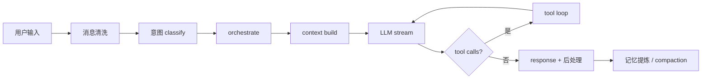
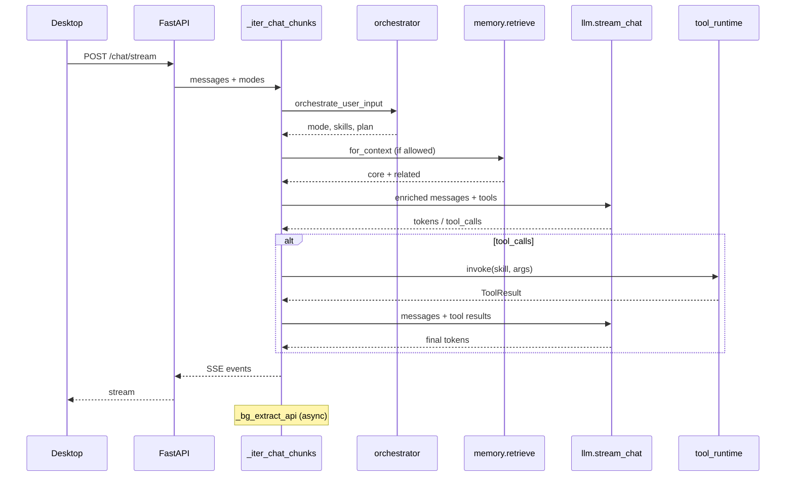

# 用户消息数据流

描述 **Desktop 流式聊天**（`POST /chat/stream` → `_iter_chat_chunks`）从输入到回复的主路径。CLI REPL 逻辑类似，但事件不序列化为 SSE。

---

## 总览



---

## 分步说明

### 1. Input — 请求进入

Desktop 发送：

```json
{
  "messages": [ … ],
  "memoryMode": "conservative",
  "obsidianMode": "summary",
  "fileRefs": [ … ]
}
```

`fastapi_app` 校验 token → `_clean_chat_messages` / `_clean_file_refs` / mode 枚举。

### 2. Intent classify — 规则 + 可选 LLM

`core/context.classify_query_intent(query, history)`：

- 输出 `intent`（chat / task / decision / …）
- `needs_memory`、`needs_tools` 等布尔信号
- 用于 conservative 记忆门控与工具预检

### 3. Orchestrate — 回合编排快照

`core/orchestrator.orchestrate_user_input()`：

- 在 intent 之上补充 **mode**（coach / listener / …）、**depth**、**memory_scope**
- **matched_skills**、**side_effect_level**
- 生成 SSE `orchestrationEvent`；可选 `build_task_plan` → `planEvent`

若 `persona.mode_auto == false`，后续 stance 以 `current_mode` 为准。

### 4. Context build — 注入 system 层

按顺序 enrich `messages`：

| 步骤 | 模块 | 条件 |
|------|------|------|
| 文件引用 | `_file_reference_context` | `fileRefs` 非空 |
| 记忆检索 | `memory.retrieve` | `memoryMode` ≠ off，且 conservative 时 `needs_memory` |
| Obsidian | obsidian 技能/检索 | `obsidianMode` ≠ off |
| Web 预搜索 | web_search | skill_router 命中 |
| 编排块 | orchestrator | task plan / mode constraints / matched skills |
| Stance | `_get_mode_prompt` | 当前 mode |
| System prompt | `context.build_system_prompt` | COVENANT / Soul / Expert overlay / Personality / Stance / Skill context，再加 MEMORY 与 ARCHER.md。顺序常量：`core.agent_profile.PROFILE_PROMPT_ORDER` |
| 模型选型 | `core/model_select` | `model_auto` |

记忆检索与 system prompt 构建带 observability span（`memory.retrieve`、`context.build_system_prompt`）。

### 5. LLM call — 流式生成

`core/llm.stream_chat(enriched_messages, tools=…)`：

- 注入本轮 `_select_api_skills` / desktop tool router 选中的 tool schemas
- Token 用量写入 `core/token_usage`（session + last call）
- SSE：`ready` → 多个 `token` →（可能中断）`error` / `done`

### 6. Tool loop — 多轮工具

当模型返回 `tool_calls`：

1. **PreToolUse** hooks（`core/hooks`）
2. 策略层：风险分级、Shell/GitHub 确认、draft 持久化
3. `core/tool_runtime.invoke` 或 TS bridge / MCP deferred load
4. 工具结果截断 → artifact；SSE **toolEvent**
5. **PostToolUse** hooks
6. 工具结果 append 到 messages → 再次 `stream_chat`（轮数上限 `tools.max_rounds`）

Desktop 高风险工具走 `POST /tool-approvals` 异步批准。

### 7. Response — 结束与后处理

- 流末尾：`done`
- 后台线程 `_bg_extract_api`：会话结束提炼 → `memory/extract` → pending 队列
- 可选 `maybe_run_memory_compaction_after_turn` → `memory.compact` toolEvent
- Token 统计已在 LLM 层记录；Desktop Composer 读 `/status.tokenUsage`

---

## 并行路径（非每轮）

| 路径 | 触发 |
|------|------|
| Background Jobs | `POST /jobs`，独立线程 `_run_job_chat_with_tools` |
| Scheduled tasks | CLI/API 启动或 `/schedules/{id}/run` → `core/scheduler.run_task` |
| Session 持久化 | Desktop `POST /sessions` / append |

---

## 关键文件

| 文件 | 阶段 |
|------|------|
| `terminal/api/_tools.py` | `_iter_chat_chunks` 主编排 |
| `core/orchestrator.py` | intent 扩展、plan、compaction 钩子 |
| `core/context.py` | system prompt、intent、stance |
| `core/tool_loop.py` | 多轮 tool + hooks |
| `core/llm.py` | stream_chat、配置、token |
| `memory/retrieve.py` | 上下文记忆 |
| `memory/extract.py` | 回合后提炼 |

---

## 序列图（单轮 happy path）



---

## 相关文档

- API 字段细节：`docs/api-contract.md`
- 记忆系统：`docs/memory-system.md`
- 可观测 span：`docs/p5-observability-design.md`
- Token 追踪：`docs/p5-token-tracking-design.md`
