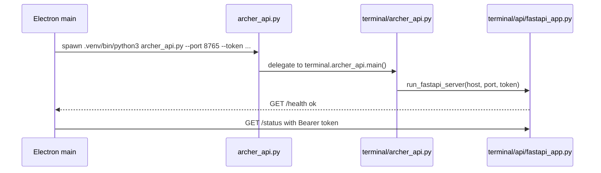

# Archer Part 7 Architecture Audit

Date: 2026-06-20
Status: superseded by 2026-06-22 closeout; kept as audit trail

## Executive Finding

Part 7 is directionally correct, but the architecture note needs one fact corrected before implementation continues: the current desktop API entrypoint is not a pure legacy `http.server` runtime anymore.

`client/desktop/src/main/index.ts` spawns the root compatibility script `archer_api.py`. That script delegates to `terminal/archer_api.py`, and `terminal/archer_api.py` now defaults to `terminal/api/fastapi_app.py` unless `--legacy` is passed. The old `ThreadingHTTPServer` handler still exists as a fallback path.

This changes the Part 7 sequence:

1. Do not start with a broad "migrate from legacy HTTP server to FastAPI" rewrite.
2. First prove the FastAPI entrypoint is complete and is the actual desktop runtime.
3. Then remove or isolate the remaining legacy monkeypatch and handler paths after snapshot parity is proven.

## Current API Startup Chain

## Startup Risks

| Area | Current state | Risk | Next action |
|---|---|---|---|
| Project path | self-use default `/Users/Yivxer/Projects/Archer`, overridable with `ARCHER_ROOT` | Acceptable for self-use, less brittle for dev smoke | Packaging strategy later |
| Python path | default `.venv/bin/python3`, overridable with `ARCHER_PYTHON_BIN` | API can start from alternate venv/interpreter | Add clearer brain status reason later |
| API script | root `archer_api.py` compatibility wrapper, overridable with `ARCHER_API_SCRIPT` | OK, docs should name both wrapper and real module | Keep wrapper for compatibility |
| Port | fixed `8765` | Port conflict remains possible | Keep reclaim logic; add readiness check |
| Token | generated in Electron userData, 0o600 | Good enough | Keep |
| Watchdog | 45s periodic health check plus restart on process exit | Helps, but silent connection death can linger | Add `/ready`; later shorten recovery path |

## API Runtime State

| Runtime | File | Status |
|---|---|---|
| FastAPI | `terminal/api/fastapi_app.py` | Default runtime when `terminal/archer_api.py` starts without `--legacy` |
| Legacy HTTP | `terminal/archer_api.py` handler | Fallback only with `--legacy` |
| Route logic | `terminal/api/_routes.py` | Shared by FastAPI and legacy runtime |
| Streaming logic | `terminal/api/_tools.py` | Shared by FastAPI and legacy runtime |

## Monkeypatch Risk

`terminal/archer_api.py` still contains `_with_legacy_tool_bindings()` and `_iter_api_tool_events()` that patch functions on `terminal.api._tools`. This is still a real concurrency risk, but it appears isolated to the legacy compatibility path. The FastAPI app imports `_iter_chat_chunks` directly from `_tools.py` and does not call those legacy patch helpers.

Decision: treat monkeypatch removal as a cleanup after FastAPI parity is proven, not as the first blocking task.

## Python Core vs TS Runtime Boundary

Current TS runtime files are closer to a UI cache and event-rendering layer than a second brain:

| State | Source of truth | TS role |
|---|---|---|
| memory | Python / SQLite | render, review actions |
| soul | Python / files / SQLite | render, import/review actions |
| tool events | Python SSE | convert and render |
| approvals | Python API plus TS pending UI cache | collect user decision, submit result |
| jobs | Python job store | render, poll/fetch, spawn UI |
| runtime session events | Python SSE plus localStorage cache | local recovery cache |

Decision: keep TS modules, but move them toward read-through caches fed by SSE plus explicit fetch fallback. Do not delete the runtime layer wholesale.

## Skill System Boundary

Current skill execution is mixed by design:

- Python skills remain the primary capability layer.
- Some TS skills exist for local desktop operations.
- `core/tool_runtime.py` / `core/ts_skill_bridge.py` already support TS-first with Python fallback for selected skills.

Current audit:

| Runtime | Count | Entry |
|---|---:|---|
| Python skills | 40 registered | `skills.loader.register_all_skills()` |
| TS local skills | 6 registered | `client/desktop/src/agent/skills/localSkillBridge.ts` |

Duplicated or overlapping capabilities:

| Skill | Python | TS | Recommendation |
|---|---|---|---|
| `obsidian_read` | full Python skill | TS local read | Keep TS for Desktop-local fast path; Python remains fallback |
| `obsidian_write` | full Python skill | TS local write | Keep both until approval/state source is fully Python-owned |
| `file_ops` | broader read/write/list behavior | TS read/list subset | Keep TS subset; fallback for write/unsupported actions |
| `file_search` | Python search | TS local search | Keep both until routing telemetry shows one can be retired |
| `web_fetch` | Python fetch | TS fetch with local URL safety | Keep both; normalize safety policy before consolidation |
| `web_search` | Python search | TS DDG search | Keep both; do not migrate search while API stability is the active goal |

Decision: do not force MCP migration in Part 7. Treat MCP as a later interface target after API/runtime state is stable. The immediate Part 7 goal is to make the current TS-first/Python-fallback behavior explicit and observable, not to delete one side.

## Immediate Corrections To Part 7

1. Mark FastAPI as the current default API runtime, not dead code.
2. Reframe P7.3 from "FastAPI migration" to "FastAPI parity and legacy cleanup".
3. Add `/ready` to distinguish process liveness from API readiness.
4. Defer legacy monkeypatch deletion until after route and SSE snapshot parity.
5. Do not create git tags while the worktree has unrelated dirty changes; record baseline files first.

## First Batch Completed

- Added public `GET /ready` in FastAPI with `{ "ok": true, "ready": true, "runtime": "fastapi" }`.
- Added shared legacy dispatcher response for `GET /ready` with `runtime: "legacy"`.
- Allowed legacy `GET /ready` without bearer auth, matching `/health`.
- Added FastAPI route coverage for `/ready`.
- Recorded P7 baseline in `docs/refactor/p7-baseline-2026-06-20.md`.
- Completed initial skill-system audit: 40 Python registered skills, 6 TS local skills, explicit overlap table.
- Added Electron API launch path overrides: `ARCHER_ROOT`, `ARCHER_PYTHON_BIN`, `ARCHER_API_SCRIPT`.
- Split Desktop brain status into `missing_python`, `missing_script`, `port_down`, `not_ready`, `token_mismatch`, `owned`, and `reused`; `/ready` now participates in status checks.
- Settings now surfaces the specific brain-status reason so local connection failures show the likely fix path.
- Added a manual Settings action to restart the local API process through Electron main (`archer:restart-api`).
- API spawn now waits for `/ready` instead of only `/health`, separating liveness from readiness.
- Renderer `ensureLocalConnection()` now validates `/ready`, so chat/model actions require readiness rather than basic liveness.
- Electron API restart now uses a single scheduled ensure with exponential backoff capped at 5s, avoiding overlapping restart timers.
- Electron watchdog now runs a lightweight `/ready` heartbeat every 5s and schedules restart on readiness failure.
- API error responses now normalize `error`, `message`, and `detail` at the FastAPI and legacy JSON exits.

## P7.6 Connection Stability Status

Completed on 2026-06-20:

- `GET /health` and `GET /ready` exist in FastAPI and legacy fallback.
- Electron API spawn waits for `/ready`.
- Renderer connection checks wait for `/ready`.
- Electron main has a 5s readiness heartbeat.
- Restart scheduling uses one timer with exponential backoff capped at 5s.
- Settings can manually restart the local API process.
- Settings shows concrete failure reasons and fix hints.
- Error JSON is normalized to `error/message/detail`.

Verification:

- Desktop Vitest: 21 files / 108 tests passed.
- Python focused route/auth tests: 18 passed.
- Desktop build: passed, **build verified** only.
- Electron dev smoke: `npm run dev` started API pid 93421, `GET /ready` returned ready, killing pid 93421 recovered to new API pid 94254 with `GET /ready` passing; logs showed `process_exit` scheduled a 1s API ensure. This is **dev verified** for kill-and-restore.

Not yet done:

- Packaged app rebuild/install.
- Packaged app runtime smoke.

## P7.4 FastAPI Entry Switch Status

Completed on 2026-06-20:

- `terminal/api/fastapi_app.py` now has its own CLI entrypoint accepting `--host`, `--port`, and `--token`.
- The standalone FastAPI entrypoint configures the existing `logs/archer_api.log` output.
- Electron launch defaults now resolve `apiScript` to `terminal/api/fastapi_app.py`.
- `ARCHER_API_SCRIPT` remains available for wrapper or legacy smoke overrides.
- The root `archer_api.py` compatibility wrapper and `terminal/archer_api.py --legacy` path remain intact.
- `_with_legacy_tool_bindings()` is not used by the default FastAPI desktop path anymore; it remains only in the explicit legacy fallback.
- FastAPI wildcard `GET` and non-stream `POST` dispatch now run synchronous `payload_get` / `payload_post` work through `run_in_threadpool`.

Verification:

- Desktop focused Vitest: `src/main/apiProcess.test.ts` 15 passed.
- FastAPI route tests: 14 passed.
- Direct FastAPI entry smoke on port 18766: `/ready` passed and authorized `/status` returned `adapter=local`.
- Electron dev smoke: `npm run dev` spawned API pid 2323 through the new default entry and `/ready` passed on port 8765.
- P7.4 contract snapshot on port 18767: `/health`, `/ready`, and `/status` top-level keys match the P7 baseline; snapshots are in `/tmp/archer_p74_contract_2026-06-20`.
- P7.4 focused Python baseline: `tests/test_fastapi_routes.py tests/test_desktop_api.py::TestDesktopApiAuth` 20 passed.
- Desktop build: passed, **build verified** only.

Not yet done:

- Packaged app rebuild/install.
- Legacy HTTP server removal.

## P7.4 SSE Blocking Audit

Checked on 2026-06-20:

- Local Starlette version: 1.0.0.
- `StreamingResponse.__init__()` keeps async iterables as-is, but wraps sync iterables with `iterate_in_threadpool(content)`.
- `iterate_in_threadpool()` advances the iterator with `anyio.to_thread.run_sync(...)` for each chunk.
- Current `_chat_stream_events()` is a sync iterator, so the existing `StreamingResponse(_chat_stream_events(...))` path is already threadpool-wrapped by Starlette.

Decision:

- Do not mechanically rewrite `_chat_stream_events()` to an async generator just to satisfy the original plan wording.
- Keep the current sync generator until there is a measured concurrency problem or a specific async dependency boundary.
- The remaining P7.4 risk is broader blocking work in non-stream request dispatch and any long synchronous post-stream side effects, not this SSE iterator shape by itself.

## P7.5 Runtime Data-Flow Status

Completed on 2026-06-21:

- `createPersistentEventLog()` now acts as a bounded recovery cache instead of an unbounded second runtime log.
- Persistent localStorage events are limited to Python/API-pushed runtime event types: tool requests/results, approvals, jobs, plans, orchestration, and status.
- Text stream deltas/finals and runtime errors are not persisted, so localStorage does not become a second chat transcript.
- The persistent cache keeps only the latest 200 events.
- `runtimeStore.ts` now exposes `restoreRuntimeStateFromEvents()`, making restored runtime state an event-replay projection.
- `ChatPage` restores runtime state through the agent runtime store instead of owning a separate page-local replay reducer.
- `taskRouter.ts` no longer auto-routes large or implementation-style requests to background jobs. Those requests stay in the foreground so Python Orchestrator remains the routing owner.
- TS still preserves foreground safety exceptions for Hugo publish and approval-first requests.
- `pythonBridge.ts` now owns Python stream payload to `AgentEvent` normalization via `pythonStreamPayloadToAgentEvents()`.
- `localArcher.ts` still surfaces raw Python `ToolEvent` cards, but no longer constructs each AgentEvent type itself.

Verification:

- Desktop agent Vitest: `src/agent/__tests__` 10 files / 51 tests passed.
- `taskRouter` focused Vitest: 7 passed.
- Desktop full Vitest: 21 files / 112 tests passed.
- Desktop build: passed, **build verified** only.

Not yet done:

- Packaged app rebuild/install.

## P7.7 Workspace IA Status

Completed on 2026-06-21:

- Added `docs/refactor/p7-workspace-ia-2026-06-21.md`.
- Added `docs/adr/0001-p7-workspace-information-architecture.md`.
- Defined target surfaces: Today/Home, Workspace, Review, Soul, Settings.
- Mapped existing routes to target surfaces while keeping compatibility render targets.
- First UI slice: sidebar labels now expose `Workspace` for the current Chat route and `Review` for the current Sessions route.
- Existing routes remain available; Tasks and Memory are not hidden yet.
- Extracted the previous inline Sessions page from `main.tsx` into `pages/ReviewPage.tsx`.
- Review now provides direct actions into Memory review and Soul review surfaces while preserving session restore behavior.
- Workspace now has a context side panel inside `ChatPage`: current expert, model profile, memory mode, Obsidian mode, runtime job count, quick starters, and links to Tasks/Memory/Settings.
- The Workspace panel is desktop-only; small screens keep the previous single-column chat layout.
- Memory API now exposes `sessionId` for confirmed memories when the underlying memory has `session_id`.
- Review now shows related memories for the selected session, preferring exact `sessionId` matches and falling back to title/preview/expert/tone keyword matching.
- Review now shows compact weekly/monthly/life-stage review signals plus the latest configured journal review entry.
- Review now embeds a pending memory panel so recent pending memories can be accepted/rejected inside the review workflow.
- App-level memory state patching is shared by Review and Memory, keeping the sidebar pending badge in sync after inline review actions.
- Workspace now embeds a background job summary panel: it loads `/jobs`, merges current runtime jobs, and shows the latest 3 jobs with status and preview.
- Review now embeds a saved-memory group summary, showing the top block-type groups and representative memories before linking to the full Memory page.
- Review now embeds a structured Soul Profile summary, showing up to 4 sections and representative items before linking to the full Soul page.
- Reusable UI panels were extracted into `components/ReviewPanels.tsx` and `components/WorkspaceContextPanel.tsx`.
- P7.7 is considered complete under the boundary: core functions are surfaced in Workspace/Review panels; full task actions, memory editing, and Soul file editing remain available as deeper pages.

Verification:

- Python focused memory/session tests: 29 passed.
- Desktop full Vitest: 21 files / 112 tests passed.
- Desktop build: passed, **build verified** only.

Not yet done:

- Packaged app rebuild/install.

## 2026-06-22 Closeout Note

This audit report is now historical context. Part 7 implementation continued through P7.8 and is closed out in:

- `docs/refactor/p7-closeout-2026-06-22.md`

Final engineering status:

- P7.1-P7.8 are complete.
- Python full test suite reached `1091 passed`.
- Desktop Vitest reached `21 files / 112 tests passed`.
- Desktop build, package, local install, and `/Applications/Archer.app` signature verification passed.
- Remaining gates are non-code: three-day real-use stability observation, optional external review, and git cleanup/tag strategy.
