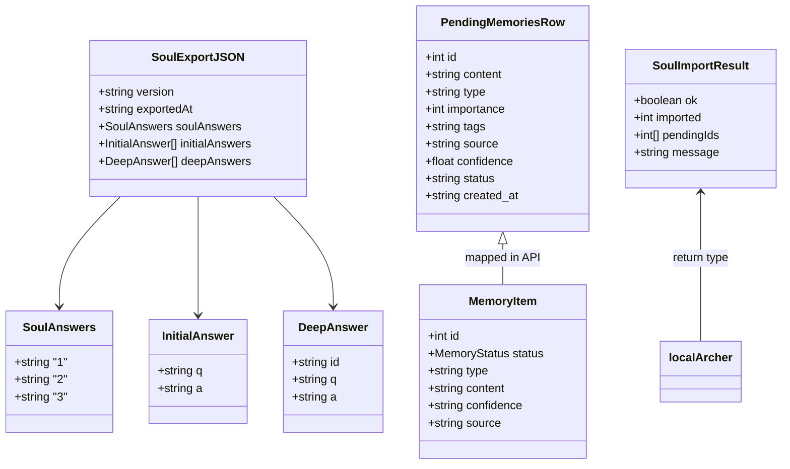
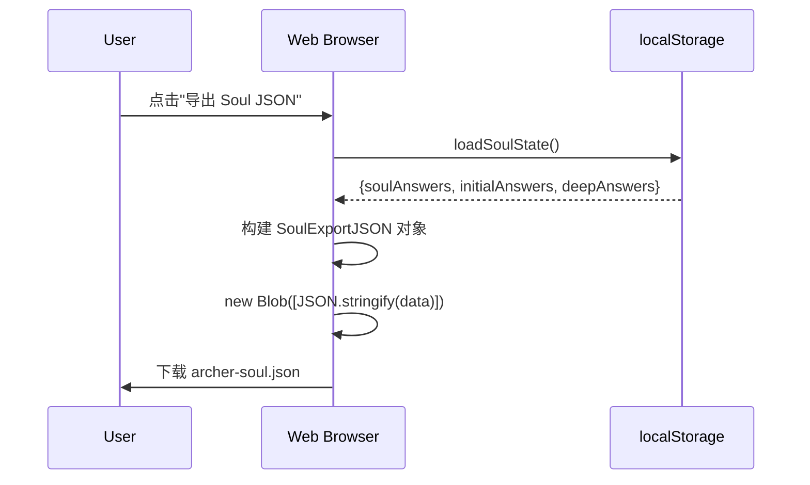
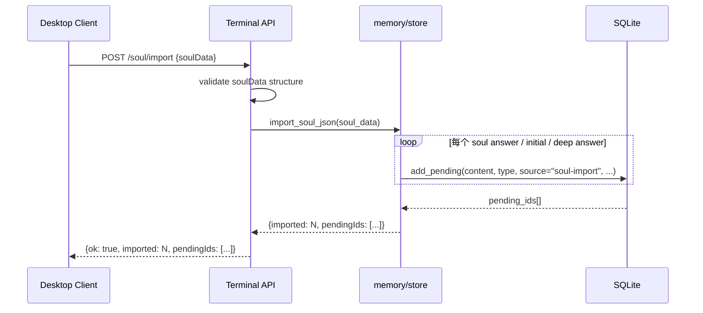
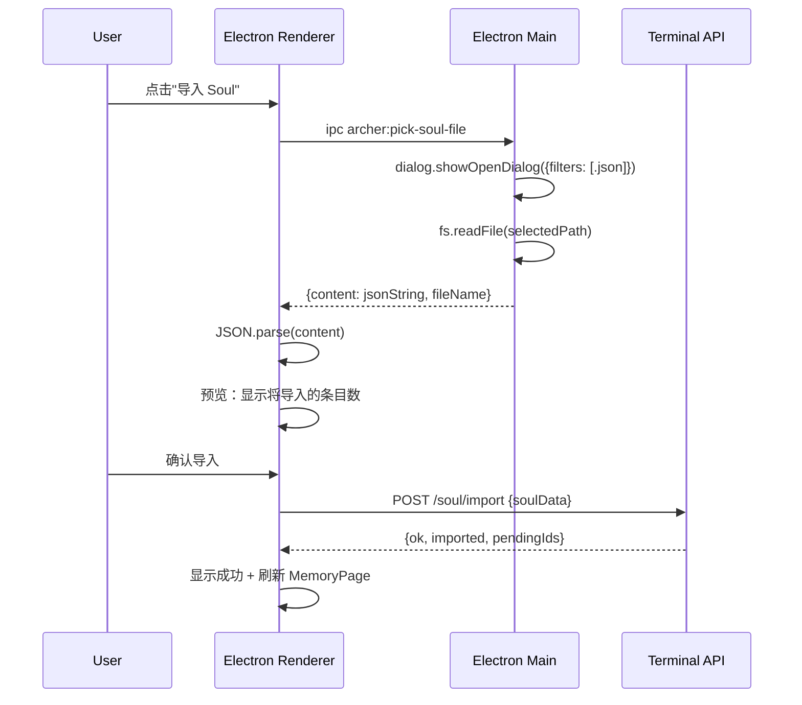
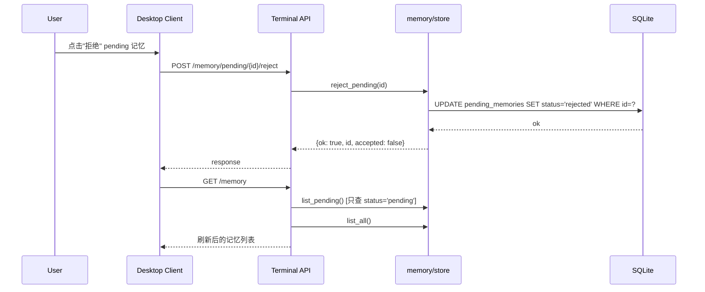
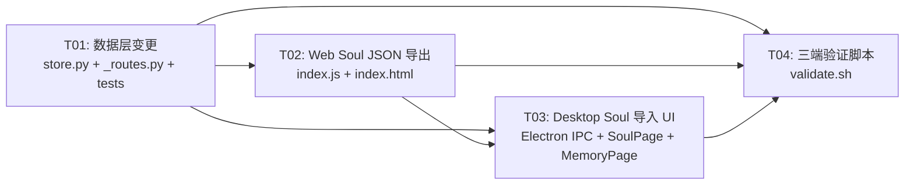

# Archer Phase 5 — System Design

> Author: Gao (Architect) | Date: 2025-05-19

---

## Part A: System Design

### 1. Implementation Approach

#### Core Technical Challenges

1. **Soul JSON 导出格式设计**：Web 端 Soul 状态存储在 `localStorage` 的扁平 JSON 中（`soulAnswers`/`initialAnswers`/`deepAnswers`），需定义一个与 Terminal `add_pending()` 兼容的导入格式，使得每条 Soul 回答能映射为一条 `pending_memory`。

2. **pending_memories 软删除**：当前 `reject_pending()` 直接 DELETE 行，需增加 `status` 列实现软删除（`pending`/`rejected`），同时保证现有代码的 `list_pending()`/`count_pending()` 默认只查 `status='pending'`，避免返回已拒绝记录。

3. **Desktop 文件上传流**：Electron sandbox 模式下 renderer 无法直接读文件，需通过 IPC → Main 进程 `dialog.showOpenDialog` + 文件读取 → 返回 JSON 内容给 renderer。

4. **三端验证脚本**：需要在单一 bash 脚本中协调 Python 虚拟环境、Node.js 环境和文件系统检查，同时保持可读性和失败时的清晰诊断。

#### Framework Selections

| 领域 | 选择 | 理由 |
|------|------|------|
| Web Soul JSON 导出 | 纯 JavaScript（与现有 `index.js` 一致） | 无需新依赖，直接复用 `loadSoulState()` |
| Terminal API 端点 | Flask（现有框架） | 在 `_routes.py` 的 `payload_post` 中新增路由 |
| Desktop UI | React + MUI 风格（与现有组件一致） | 复用 `localArcher.ts` 的 API 适配器模式 |
| Desktop 文件选择 | Electron IPC `archer:pick-soul-file` | 复用 `archer:pick-files` 的模式 |
| DB Migration | SQLite `ALTER TABLE` 幂等补列 | 与现有 `init_db()` 模式一致 |
| 验证脚本 | Bash + Python subprocess | 根目录已有 `run_tests.sh` 的模式 |

#### Architecture Pattern

沿用现有的三层架构：
- **Web（纯静态 SPA）**：`index.html` + `assets/index.js`，零构建步骤
- **Terminal（Python Flask API）**：`terminal/api/_routes.py` 路由分发 + `memory/store.py` 数据层
- **Desktop（Electron + React）**：`src/main/` IPC → `src/renderer/` React UI → `localArcher.ts` API 适配

---

### 2. File List

```
# P2-1: Soul 建档结果进入本地 Archer
web/public/assets/index.js                           # 修改：新增 downloadSoulJson()
web/public/index.html                                # 修改：新增"导出 JSON"按钮

terminal/api/_routes.py                              # 修改：新增 POST /soul/import 路由
terminal/api/_config.py                              # 可能修改：新增 Soul JSON 解析辅助函数

memory/store.py                                      # 修改：新增 import_soul_json() 批量写入 pending

client/desktop/src/main/index.ts                     # 修改：新增 archer:pick-soul-file IPC handler
client/desktop/src/preload/index.ts                  # 修改：暴露 pickSoulFile 方法
client/desktop/src/renderer/src/adapters/localArcher.ts  # 修改：新增 importSoul() API 调用
client/desktop/src/renderer/src/types.ts             # 修改：新增 SoulImportResult 类型
client/desktop/src/renderer/src/pages/SoulPage.tsx   # 修改：新增导入 UI 区域

# P2-2: 客户端记忆审阅体验
memory/store.py                                      # 修改：pending_memories 加 status 列，reject 改软删除，list/query 支持 rejected
terminal/api/_routes.py                              # 修改：/memory 返回 source，新增 rejected 筛选
client/desktop/src/renderer/src/types.ts             # 修改：MemoryItem 加 source 字段，MemoryStatus 加 rejected
client/desktop/src/renderer/src/pages/MemoryPage.tsx # 修改：筛选支持 rejected，MemoryCard 显示来源

# P2-3: 三端验证脚本
scripts/validate.sh                                  # 新建：三端验证脚本
```

---

### 3. Data Structures and Interfaces



#### pending_memories Schema 变更

```sql
-- 现有 schema
CREATE TABLE pending_memories (
    id         INTEGER PRIMARY KEY AUTOINCREMENT,
    content    TEXT    NOT NULL,
    type       TEXT    DEFAULT 'insight',
    importance INTEGER DEFAULT 3,
    tags       TEXT    DEFAULT '',
    source     TEXT    DEFAULT 'auto',
    confidence REAL    DEFAULT 0.7,
    created_at TEXT    NOT NULL
);

-- Phase 5 新增
ALTER TABLE pending_memories ADD COLUMN status TEXT DEFAULT 'pending';
-- status 取值: 'pending' | 'rejected'
```

#### Soul Export JSON 格式

```json
{
  "version": "1.0",
  "exportedAt": "2025-05-19T14:30:00+08:00",
  "soulAnswers": {
    "1": "用户称呼",
    "2": "最近常想",
    "3": "希望如何"
  },
  "initialAnswers": [
    { "q": "灵魂十问问题1", "a": "回答" }
  ],
  "deepAnswers": [
    { "id": "q-hash-1", "q": "深度问题", "a": "回答" }
  ]
}
```

---

### 4. Program Call Flow

#### 4.1 Soul JSON 导出（Web）



#### 4.2 Soul JSON 导入（Terminal API）



#### 4.3 Desktop Soul 导入 UI 流程



#### 4.4 pending_memories 软删除流程



---

### 5. Anything UNCLEAR

1. **Soul JSON 导入后的类型映射**：Soul 回答应映射为什么 memory type？当前设计建议：
   - soulAnswers → `identity` (importance=4)
   - initialAnswers → `preference` (importance=3)
   - deepAnswers → `insight` (importance=3)
   - 需确认此映射是否合理，或是否需要 AI 辅助分类。

2. **rejected 记忆的保留期限**：软删除后是否需要定期清理（如 30 天后真删除），还是永久保留？当前设计按永久保留处理。

3. **Web 端是否需要直接导入能力**：当前需求只提 Desktop 导入，Web 端导出即可。如果未来 Web 也需导入（通过拖拽），需额外设计。

4. **Soul 导入的幂等性**：同一份 Soul JSON 重复导入是否应去重？当前设计中 `add_pending()` 不做内容去重（与现有 `save()` 行为不同），需确认。

---

## Part B: Task Decomposition

### 6. Required Packages

```
# 无新增依赖
# Web: 纯 JS，无新包
# Terminal: Python 标准库 json + 现有 Flask
# Desktop: 现有 React + Electron 依赖
# Scripts: Bash + Python（已有 .venv）
```

---

### 7. Task List

#### T01: 项目基础设施 + 数据层变更
- **Source Files**:
  - `memory/store.py` — pending_memories 加 status 列 + reject 改软删除 + import_soul_json() + list_pending 支持 status 筛选 + /memory API 返回 source
  - `terminal/api/_routes.py` — POST /soul/import + /memory 返回 source + rejected 筛选
  - `tests/test_pending_memory.py` — 新增软删除测试 + soul import 测试
- **Dependencies**: None
- **Priority**: P0

#### T02: Web Soul JSON 导出
- **Source Files**:
  - `web/public/assets/index.js` — 新增 `downloadSoulJson()` + `buildSoulJson()` 函数
  - `web/public/index.html` — 新增"导出 Soul JSON"按钮
- **Dependencies**: T01 (需确认 JSON 格式)
- **Priority**: P0

#### T03: Desktop Soul 导入 UI
- **Source Files**:
  - `client/desktop/src/main/index.ts` — 新增 `archer:pick-soul-file` IPC handler
  - `client/desktop/src/preload/index.ts` — 暴露 `pickSoulFile`
  - `client/desktop/src/renderer/src/adapters/localArcher.ts` — 新增 `importSoul()`
  - `client/desktop/src/renderer/src/types.ts` — 新增 `SoulImportResult` + `MemoryItem` 加 `source` + `MemoryStatus` 加 `'rejected'`
  - `client/desktop/src/renderer/src/pages/SoulPage.tsx` — 新增导入 UI
  - `client/desktop/src/renderer/src/pages/MemoryPage.tsx` — 筛选支持 rejected + MemoryCard 显示来源
- **Dependencies**: T01 (API 端点), T02 (JSON 格式)
- **Priority**: P0

#### T04: 三端验证脚本
- **Source Files**:
  - `scripts/validate.sh` — Python 模块导入 + 命令注册 + Desktop build + Web 部署文件检查
- **Dependencies**: T01, T02, T03 (验证所有新功能)
- **Priority**: P1

---

### 8. Shared Knowledge

```
- Soul JSON 导出格式版本：v1.0，包含 version/exportedAt/soulAnswers/initialAnswers/deepAnswers
- pending_memories 新增 status 列：'pending'(默认) | 'rejected'，现有数据自动填充 'pending'
- list_pending() / count_pending() 默认只查 status='pending'，不返回 rejected 记录
- reject_pending() 改为 UPDATE status='rejected'，不再是 DELETE
- /memory API 返回中 MemoryItem 新增 source 字段
- Soul 导入 source 固定为 'soul-import'，便于后续筛选
- Desktop IPC 通道命名规范：archer:pick-soul-file（复用 archer: 前缀）
- 所有 API 响应保持现有格式，不引入新的错误码
- Soul 导入仅创建 pending 记忆，需用户在 MemoryPage 确认后才写入正式记忆库
- Desktop MemoryStatus 扩展为 'confirmed' | 'pending' | 'rejected'
```

---

### 9. Task Dependency Graph



---

## API Design

### POST /soul/import

**Request:**
```json
{
  "soulData": {
    "version": "1.0",
    "exportedAt": "...",
    "soulAnswers": { "1": "...", "2": "...", "3": "..." },
    "initialAnswers": [{ "q": "...", "a": "..." }],
    "deepAnswers": [{ "id": "...", "q": "...", "a": "..." }]
  }
}
```

**Response (200):**
```json
{
  "ok": true,
  "imported": 5,
  "pendingIds": [101, 102, 103, 104, 105],
  "message": "已导入 5 条 Soul 记忆为待确认状态"
}
```

**Response (400):**
```json
{
  "ok": false,
  "imported": 0,
  "pendingIds": [],
  "message": "soulData 格式无效：缺少 soulAnswers 字段"
}
```

### GET /memory (修改)

**新增 query 参数：**
- `include_rejected=true` — 同时返回 status='rejected' 的 pending 记录
- 默认不返回 rejected

**Response 变更：** MemoryItem 新增 `source` 字段

```json
{
  "id": 1,
  "status": "pending",
  "type": "identity",
  "content": "...",
  "confidence": "0.70",
  "source": "soul-import"
}
```

### POST /memory/pending/{id}/reject (行为变更)

**之前：** 硬删除（DELETE FROM pending_memories）
**现在：** 软删除（UPDATE pending_memories SET status='rejected'）

Response 格式不变。
